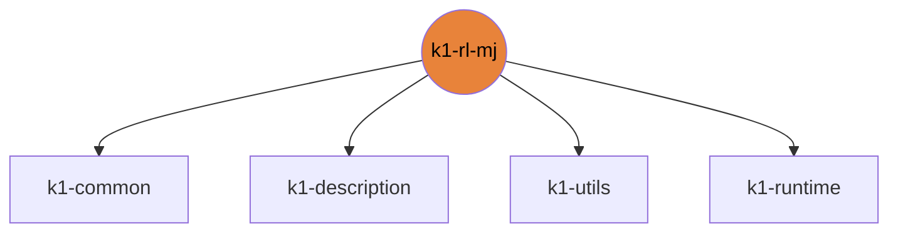

# k1-rl-mj

mjlab (MuJoCo Warp) tasks, probes and train/play CLI.

| | |
|---|---|
| Layer | **L2**: Domain (no cross-imports) |
| May import | [k1-common](https://github.com/thdhyan/k1-common), [k1-description](https://github.com/thdhyan/k1-description), [k1-utils](https://github.com/thdhyan/k1-utils), [k1-runtime](https://github.com/thdhyan/k1-runtime) |
| Files / LOC | 76 files · 7,743 lines (py, sh, cpp) |
| Part of | [k1-workspace](https://github.com/thdhyan/k1-workspace) (architecture and layering rules live there) |

## Where it sits



Used by: nothing (top layer).


## Install

```bash
uv add git+https://github.com/thdhyan/k1-rl-mj
# or, from a checkout
uv sync
```

## Usage

mjlab (MuJoCo Warp) tasks. Needs `mjlab` and a CUDA GPU.

```bash
k1-train Mjlab-Velocity-Height-Flat-Booster-K1 --help   # mjlab's train flags
k1-play  Mjlab-PushIK-Booster-K1 --help
```
- `k1-train` / `k1-play` import the K1 tasks, which registers them, then hand over to mjlab's own CLIs. Run
  `k1-train --help` to see the flags.
- Tasks: Velocity-Height-{Flat,Rough}, Stand, Squat, Steps, Jump, GetUp, Track, HeadTrack, Kick*, Push, PushIK,
  PushMA, Carry*.
- Probes and exports are in `scripts/`. There are no tests yet.

## Tests

From a k1-workspace checkout (see its README, "Run the tests"):
```bash
cd libs/k1-rl-mj && python -m pytest -q tests
```

## Robots and hosts

Robot IPs, SSH aliases, network, safety and how to control each robot: [docs/ROBOTS.md](https://github.com/thdhyan/k1-workspace/blob/main/docs/ROBOTS.md) in k1-workspace.

## Environment variables read

`K1_ACTION_SCALE`, `K1_ACTUATORS`, `K1_ACT_RATE_W`, `K1_AIR_W`, `K1_ANG_VEL_W`, `K1_ARTICULATION`, `K1_BASE_CKPT`, `K1_CARRY2_ASSIST_S`, `K1_CARRY2_CONE`, `K1_CARRY2_IMPRATIO`, `K1_CARRY2_MASS`, `K1_CARRY2_MU`, `K1_CARRY2_SQUEEZE`, `K1_CARRY_MASS`, `K1_CV_BASE`, `K1_CV_MASS_MAX`, `K1_CV_MASS_MIN`, `K1_CV_RESIDUAL`, `K1_CV_VX_MAX`, `K1_CV_WZ_MAX`, `K1_EVAL_PROG`, `K1_FEET_MIN`, `K1_FEET_W`, `K1_FELL_ANGLE`, `K1_FLAT_W`, `K1_GETUP_AR_W`, `K1_GETUP_STAND_FRAC`, `K1_H_STAND`, `K1_JOINT_ACC_W`, `K1_JUMP_BASE_CKPT`, `K1_JUMP_RESIDUAL`, `K1_KICK_`, `K1_KICK_CMD_ALPHA`, `K1_KICK_GATE`, `K1_KICK_RESIDUAL`, `K1_KMA_BASE`, `K1_KMA_CMD_ALPHA`, `K1_KS_LEVEL_UP`, `K1_KS_SIDE_FRAC`, `K1_LAND_W`, `K1_LS_ITERS`, `K1_MA_BOX_MASS`, `K1_MA_HAND_ONLY_W`, `K1_PIK_BASE`, `K1_PIK_BODY_W`, `K1_PIK_BOTH_W`, `K1_PIK_FACE_FRAC`, `K1_PIK_HALF_Z`, `K1_PIK_NEAR_FRAC`, `K1_PIK_ONE_HAND`, `K1_PUSH_V`, `K1_SHOVE_N`, `K1_SHOVE_RAMP_ITERS`, `K1_SLOPE_MAX`, `K1_STAIR_MAX`, `K1_STAND_FRAC`, `K1_STAND_W`, `K1_STEPS_BASE_CKPT`, `K1_SWING_H`, `K1_SWING_W`, `K1_SYM_W`, `K1_TERRAIN_FOCUS`, `K1_TRACK_W`, `K1_VX_MAX`, `K1_VY_W`, `K1_XML`

## Layout

```
README.md
jobs/  (7 files)
  README.md
  dl_grid_carry.sh
  dl_walk_v4.sh
  zzbw_push_ik_grid.sh
  zzbw_push_ik_post_v8.sh
  zzbw_push_ik_queue_v9.sh
  zzbw_push_ik_v10.sh
pyproject.toml
scripts/  (46 files)
  README.md
  base_probe.py
  carry_clips.py
  export_mjcf.py
  export_policy.py
  gait_probe.py
  jump_motor_test.py
  jump_probe.py
  jump_smoke.py
  kick_depth_probe.py
  kick_dir_record.py
  kick_gaze_debug.py
  kick_gaze_static.py
  kick_gaze_sweep.py
  kick_grid_render.py
  kick_ma_checks.py
  kick_ma_eval.py
  kick_ma_goal_video.py
  kick_ma_init.py
  kick_ma_layout.py
  kick_ma_smoke.py
  kick_record.py
  kick_spread.py
  kick_strike_checks.py
  kick_strike_init.py
  kick_yolo_check.py
  kick_yolo_eval.py
  mlp_check.py
  obs_check.py
  order_check.py
  push_ik_eval.py
  push_ik_probe.py
  push_ik_render.py
  push_limits.py
  push_limits_plot.py
  shove_eval.py
  skill_eval.py
  smooth_probe.py
  task_smoke.py
  term_check.py
  velocity_grid.py
  velocity_grid_gif.py
  velocity_grid_html.py
  walk_profile_gif.py
  wbc_check.py
  wbc_head_check.py
src/  (25 files)
  mjlab_k1/  (25 files)
tests/  (1 files)
  check_push_ik_parity.py
```

## Dependencies

- Declared sibling libraries: k1-common, k1-description, k1-utils, k1-runtime (see `pyproject.toml`, `[tool.uv.sources]`).
- PyPI: imageio, matplotlib, mujoco, numpy, pillow, torch.
- Provided by the environment (ROS 2, Isaac, mjlab, robot SDK) or unresolved: `mjlab`, `rsl_rl`, `tensordict`, `ultralytics`.

## Hard-coded paths into other repos

None.

## Origin

Extracted from `booster_ws` (branch `dev/push-training-wip`, working tree of 2026-11-03) by
`tools/build_workspace.py` in k1-workspace. Old path to new path for every file: [`docs/migration_map.tsv`](https://github.com/thdhyan/k1-workspace/blob/main/docs/migration_map.tsv) (filter on `k1-rl-mj`).
History was not carried over: the working tree was copied as is, including previously untracked files.
