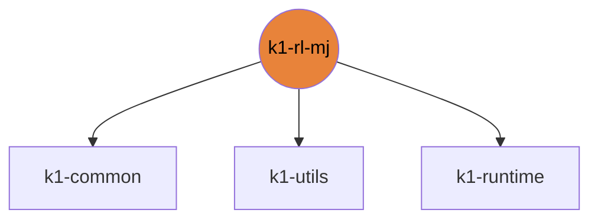

# k1-rl-mj

mjlab (MuJoCo Warp) tasks, probes and train/play CLI.

| | |
|---|---|
| Layer | **L2**: Domain (no cross-imports) |
| May import | [k1-common](https://github.com/thdhyan/k1-common), [k1-utils](https://github.com/thdhyan/k1-utils), [k1-runtime](https://github.com/thdhyan/k1-runtime) |
| Files / LOC | 75 files · 7,576 lines (py, sh, cpp) |
| Part of | [k1-workspace](https://github.com/thdhyan/k1-workspace) (architecture and layering rules live there) |

## Where it sits



Used by: nothing (top layer).


## Install

```bash
uv add git+https://github.com/thdhyan/k1-rl-mj
# or, from a checkout
uv sync
```

## Layout

```
README.md
jobs/  (7 files)
  README.md
  dl_grid_carry.sh
  dl_walk_v4.sh
  zzbw_push_ik_grid.sh
  zzbw_push_ik_post_v8.sh
  zzbw_push_ik_queue_v9.sh
  zzbw_push_ik_v10.sh
pyproject.toml
scripts/  (46 files)
  README.md
  base_probe.py
  carry_clips.py
  export_mjcf.py
  export_policy.py
  gait_probe.py
  jump_motor_test.py
  jump_probe.py
  jump_smoke.py
  kick_depth_probe.py
  kick_dir_record.py
  kick_gaze_debug.py
  kick_gaze_static.py
  kick_gaze_sweep.py
  kick_grid_render.py
  kick_ma_checks.py
  kick_ma_eval.py
  kick_ma_goal_video.py
  kick_ma_init.py
  kick_ma_layout.py
  kick_ma_smoke.py
  kick_record.py
  kick_spread.py
  kick_strike_checks.py
  kick_strike_init.py
  kick_yolo_check.py
  kick_yolo_eval.py
  mlp_check.py
  obs_check.py
  order_check.py
  push_ik_eval.py
  push_ik_probe.py
  push_ik_render.py
  push_limits.py
  push_limits_plot.py
  shove_eval.py
  skill_eval.py
  smooth_probe.py
  task_smoke.py
  term_check.py
  velocity_grid.py
  velocity_grid_gif.py
  velocity_grid_html.py
  walk_profile_gif.py
  wbc_check.py
  wbc_head_check.py
src/  (24 files)
  mjlab_k1/  (24 files)
tests/  (1 files)
  check_push_ik_parity.py
```

## Dependencies

- Declared sibling libraries: k1-common, k1-utils, k1-runtime (see `pyproject.toml`, `[tool.uv.sources]`).
- PyPI: imageio, matplotlib, mujoco, numpy, pillow, torch.
- Provided by the environment (ROS 2, Isaac, mjlab, robot SDK) or unresolved: `mjlab`, `rsl_rl`, `tensordict`, `ultralytics`.

## Hard-coded paths into other repos

None.

## Origin

Extracted from `booster_ws` (branch `dev/push-training-wip`, working tree of 2026-11-03) by
`tools/build_workspace.py` in k1-workspace. Old path to new path for every file: [`docs/migration_map.tsv`](https://github.com/thdhyan/k1-workspace/blob/main/docs/migration_map.tsv) (filter on `k1-rl-mj`).
History was not carried over: the working tree was copied as is, including previously untracked files.
